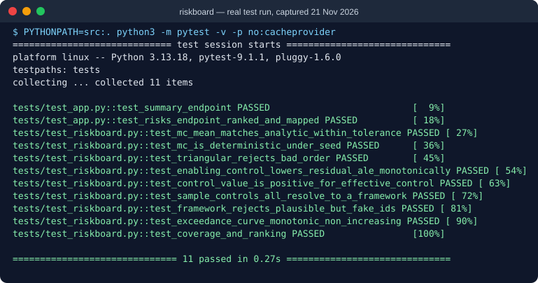

# RiskBoard — quantified risk + controls — manual

*One page, eight blocks. Every figure here comes from this repository's own tests and README.*

## 1. Claim
On the sample register, modelled exposure falls from $7.55M/yr inherent to $1.98M/yr residual (a 74% reduction), and the Monte-Carlo mean is tested to fall within 2% of the analytic expectation.

## 2. What it is
A risk register that expresses security risk in money. It simulates annual losses (FAIR-style), maps each control to ISO 27001:2022 Annex A and SOC 2, and shows what each control buys down per year, as a board dashboard and a one-page PDF.

## 3. Demo
Board dashboard `board/index.html` and the one-page `report/board-report.pdf` (both regenerated by the commands below). Live app: `python app.py`.


*Real output from this repository's own tests, captured 21 Nov 2026.*

## 4. Run it yourself
**Prerequisites:** Python 3. Flask for the live app.

```bash
pip install -e ".[dev]"
python -m riskboard.cli
python board/generate.py
python report/generate.py
pytest -q
```

## 5. What you will see
11 tests pass. The CLI prints the board summary; the generators write the dashboard and PDF.

## 6. 30-second talking point
> Boards decide in money, so I give them risk in money. RiskBoard prices each control by the annual loss it removes, and the tests pin down the maths, including rejecting framework IDs that look real but are not.

## 7. Scope and limits
- All figures are modelled estimates for board discussion, not accounting values. Outputs are only as good as the input estimates.
- Its companion, risk-optimizer, turns this into an exact spend optimum.

## 8. Links
[Repository](https://github.com/fhionnghaile/riskboard) · [Write-up](https://padraigfhionnghaile.com/work/riskboard/) · [README](README.md)
